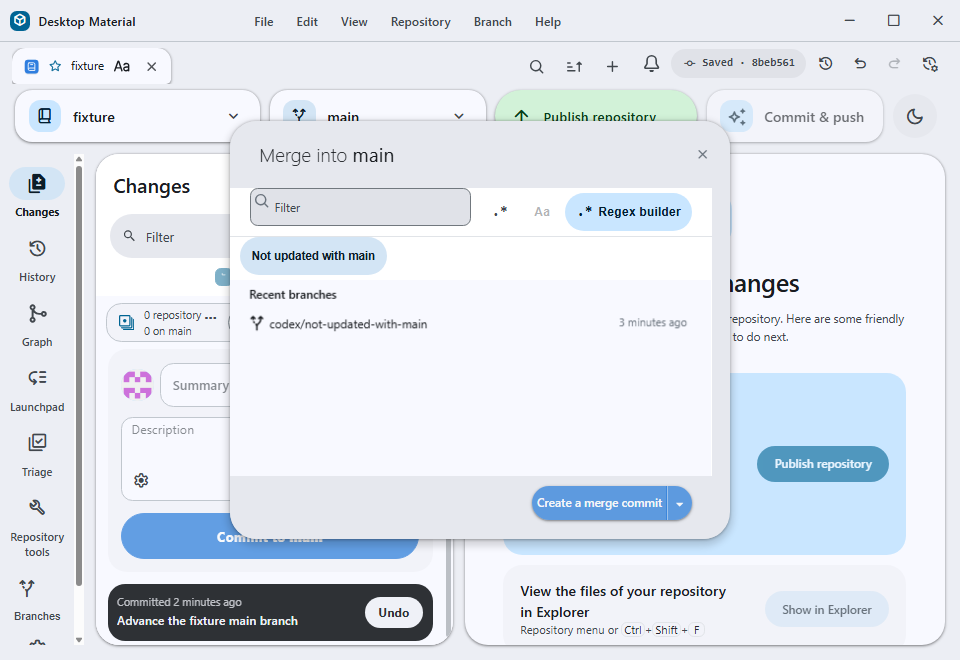

# Desktop Material

**Overview** · [Install](docs/readme-tabs/install.md) · [Features](docs/readme-tabs/features.md) · [Complete list](docs/readme-tabs/complete-feature-list.md) · [Screenshots](docs/readme-tabs/screenshots.md) · [Roadmap & receipts](docs/readme-tabs/roadmap-and-receipts.md) · [Development](docs/readme-tabs/development.md)

**總覽** · [安裝](docs/readme-tabs/install.md) · [功能](docs/readme-tabs/features.md) · [完整清單](docs/readme-tabs/complete-feature-list.md) · [截圖](docs/readme-tabs/screenshots.md) · [路線圖同憑證](docs/readme-tabs/roadmap-and-receipts.md) · [開發](docs/readme-tabs/development.md)

An independent Windows desktop client for Git and GitHub, built on [GitHub Desktop](https://github.com/desktop/desktop) with Material Design 3 controls, repository workspaces, richer review tools, and configurable appearance. The application uses TypeScript, React, Electron, and Sass. This project is independent of GitHub, Inc.

Desktop Material 係獨立嘅 Windows Git 同 GitHub 桌面用戶端，建基於 GitHub Desktop，加入 Material Design 3 控制項、儲存庫工作區、覆核工具同可自訂外觀。呢個項目並非 GitHub 官方產品。

[Documentation website](https://ding-ding-projects.github.io/desktop-material/) · [Feature articles](docs/features/README.md) · [Wiki articles](docs/wiki/README.md) · [Releases](https://github.com/Ding-Ding-Projects/desktop-material/releases)

## Current startup repair / 目前啟動修正

**The startup repair is under verification. A corrected installed release is not yet verified.** The latest release verified for this work is [`v4.0.133401`](https://github.com/Ding-Ding-Projects/desktop-material/releases/tag/v4.0.133401), from source [`cb07a90dda8778784d291fbfa09b6bb2ca2a247d`](https://github.com/Ding-Ding-Projects/desktop-material/commit/cb07a90dda8778784d291fbfa09b6bb2ca2a247d). That installed baseline still reproduces an Application Control block of `windows-argv-parser.node` during main-process loading.

The source repair replaces the native parser with in-process TypeScript, retains the integration interface and Windows quoting behavior, and preserves Unicode without the old ANSI conversion. It changes neither security settings nor stored user profiles. A separate production-build repair bounds compiler memory on smaller hosts.

| Evidence | Verified state for the repair |
| --- | --- |
| Argument parsing | 22 focused checks pass, including 2,271 nonempty comparisons with the Windows `CommandLineToArgvW` API |
| Related build contracts | 16 focused checks pass |
| Production runner | 9 focused checks pass, including sequential execution and direct Node option precedence |
| Exact root production build | Pending acceptance for the corrected candidate |
| New Squirrel package and published release | Pending |
| Corrected installed startup | Pending |
| Existing-profile startup and data preservation | Pending |

Source checks do not establish installed startup, complete UI acceptance, or publication. An earlier parallel compiler run was stopped under memory pressure and returned a nonzero result; it is diagnostic evidence only. See the [startup repair guide](docs/features/quality-and-reliability/windows-startup-argument-parser.md), [handoff](HANDOFF.md), and [roadmap](ROADMAP.md).

**啟動修正仲喺驗證中。** 原始碼檢查通過唔代表安裝後成功啟動。新套件、現有設定檔啟動同資料保留驗證仍然待完成。

## Install on Windows / Windows 安裝

The supported graphical product targets Windows. Published installation is currently **x64 and per user**. ARM64 build documentation exists, but the installer helper stops when no matching ARM64 release asset is available. The retained [Linux terminal prototype](docs/features/linux-tui/README.md) is historical, outside supported graphical-product and Windows-release acceptance. Inherited macOS/Linux desktop setup documents are upstream references.

1. Read the startup status above before selecting a release.
2. Open the [release list](https://github.com/Ding-Ding-Projects/desktop-material/releases) and review notes and assets. The baseline above does not contain a verified fix for the startup block.
3. Use the x64 Squirrel setup executable for a normal per-user installation, or extract the portable ZIP before launching its executable.

**Windows packages are intentionally unsigned.** SmartScreen or an unknown-publisher warning may appear. Unsigned status is separate from package integrity and runtime acceptance. Retain your existing security protections.

For scripted installation, review [`script/install-windows.ps1`](script/install-windows.ps1) first. From normal, non-administrator PowerShell in a trusted checkout:

```powershell
.\script\install-windows.ps1 -Operation Install -InstallScope CurrentUser
```

The helper resolves this project's stable release, verifies asset size and SHA-256 digest, checks signature status, runs Squirrel, and verifies the installed postcondition. `Update` and `Uninstall` are also supported operations. It does not force-close a running application, and rejects partial installations or unsupported scope before mutation. The MSI deployment bootstrapper does not imply an all-users application installation. See the [installation guide](docs/readme-tabs/install.md) for timeouts, recovery, and download options.

安裝只支援目前用戶範圍，請用普通、非管理員 PowerShell。套件刻意保持未簽署，下載完整性、安裝完成同實際啟動係三個獨立驗證結果。

## Repository workflows / 儲存庫工作流程

Start with a repository, review its changes, then choose the action that matches the work. These categories document behavior and verification separately.

| Workflow | Documentation |
| --- | --- |
| Open, clone, organize, and navigate repositories; manage branches and linked worktrees | [Repository management](docs/features/repository-management/README.md) |
| Track clone progress, recover interrupted clones, and handle Windows long paths | [Direct clone recovery](docs/features/repository-management/direct-clone-progress.md) |
| Sort clone candidates by name, modification, creation, or UTC-day ordering | [Clone metadata](docs/features/repository-management/clone-dialog-repository-metadata.md) |
| Fetch configured remotes and review synchronization across repositories | [Multi-remote fetch](docs/features/repository-management/multi-remote-fetch-sync.md) and [batch sync](docs/features/repository-management/reviewed-batch-sync.md) |
| Review changed-file trees, expand diff context, and inspect structured data or images | [Review and diff](docs/features/review-and-diff/README.md) |
| Create and review pull requests, inspect activity, and browse cached project information | [Collaboration](docs/features/collaboration/README.md) |
| Select accounts and repository identities; organize tabs and scheduled settings | [Identity and workspace](docs/features/identity-and-workspace/README.md) |
| Configure editors, shells, provider integrations, and the app-hosted browser | [Integrations](docs/features/integrations/README.md) |
| Adjust themes, density, command appearance, accessibility, and attention accommodations | [Design system](docs/features/design-system/README.md) |
| Use opt-in local automation with documented authentication boundaries | [Agent API](docs/features/agent-api/README.md) |
| Understand recovery, startup, resource lifecycle, and verification limitations | [Quality and reliability](docs/features/quality-and-reliability/README.md) |

The [complete feature list](docs/readme-tabs/complete-feature-list.md) is an inventory, not blanket acceptance. Individual articles and the roadmap record implementation and verification separately.

開啟儲存庫、覆核改動，再揀適合嘅操作。各個分類有完整說明；功能列喺清單入面，唔等於所有版本同畫面都已經驗證完成。

## Earlier recorded interface example / 較早記錄嘅介面例子



This genuine **960 × 660 client-area capture** shows the recorded fixture merge workflow. The [branch-switcher article](docs/features/identity-and-workspace/branch-switcher-workflows.md) and [screenshot inventory](docs/readme-tabs/screenshots.md) retain its context. The inventory records SHA-256 `DA046E4BC768324BAFF001B5DE0C7954F53F1CD498C25338081E8FDB83990346`. It is an earlier example, not a capture of the current startup-repair candidate. No capture date is inferred from file names or timestamps.

The [screenshot gallery](docs/readme-tabs/screenshots.md) contains more real recorded states and limitations. Its historical packaged refresh had scene gaps and did not pass its aggregate capture check. Current-candidate captures must follow a successful real build and startup before replacing this example or supporting a new runtime claim.

呢張係較早已建置版本嘅真實擷取，顯示測試儲存庫嘅合併流程，唔係今次啟動修正版嘅驗收證據。新版本要先成功建置同啟動，再保留真實畫面。

## Build from source / 由原始碼建置

Use a trusted checkout on Windows and run the root entrypoints from the repository directory:

```bat
build.bat /s
build-installer.bat /s
```

Both entrypoints first invoke `download-dependencies.bat`, which detects and bootstraps missing supported build prerequisites through the repository's configured routes, reusing valid tools and caches. Required native UAC consent remains the user's decision. A missing license, unavailable prerequisite, or required restart remains an explicit blocker. Success on a prepared machine does not prove a fresh-machine installation.

`/s` selects silent operation. The wrappers preserve real nonzero child exit results. Installer production uses the Squirrel packaging route; a compiler failure prevents packaging from proceeding with partial output.

On hosts with **at most 12 GiB physical memory**, production webpack runs all six configurations in separate sequential processes: main, renderer, crash, quick-action, CLI, and highlighter. Each child receives a direct **4 GiB old-space limit**. Production minification, source maps, plugins, and outputs remain enabled. Larger hosts retain the normal path. To explicitly select serial compilation in Command Prompt:

```bat
set DESKTOP_WEBPACK_SERIAL=1
build.bat /s
```

The cap bounds old space per child, not total operating-system memory. It does not guarantee success on every small host. See the [production runner explanation](docs/features/quality-and-reliability/windows-startup-argument-parser.md#production-builds-on-smaller-hosts), [development tab](docs/readme-tabs/development.md), and [Windows setup reference](docs/contributing/setup-windows.md).

兩個根目錄入口都會先處理缺少嘅建置工具，再繼續正式建置。細記憶體主機逐個編譯設定執行，每個子行程限制 4 GiB old space；呢個限制唔等於整部機嘅總記憶體上限，亦唔係成功建置保證。

## Documentation and project records / 文件同項目紀錄

- [Categorized feature articles](docs/features/README.md): workflows, configuration, failure modes, security considerations, and verification.
- [Repository wiki index](docs/wiki/README.md): user guide, developer guide, automation, API, regex, submodules, and gallery articles.
- [GitHub wiki](https://github.com/Ding-Ding-Projects/desktop-material/wiki): hosted wiki surface.
- [Documentation website](https://ding-ding-projects.github.io/desktop-material/): public documentation entry point.
- [Roadmap](ROADMAP.md): checked work and outstanding verification, grouped by milestone.
- [Handoff](HANDOFF.md): source identities, historical receipts, blockers, and next actions.
- [Roadmap and receipts tab](docs/readme-tabs/roadmap-and-receipts.md): navigation to additional evidence.
- [Contributor setup](docs/contributing/setup.md) and [agent instructions](AGENTS.md): development and repository conventions.

Source documentation, the hosted website, and the wiki have separate publication states. A README edit does not prove deployment or a new release. Release line-count figures belong to their exact published release; this README does not substitute a hand-edited count.

文件原始碼、網站同 wiki 各有獨立發佈狀態。更新 README 唔等於網站已部署，亦唔代表新版本已發佈。

## License and attribution / 授權同鳴謝

Desktop Material is distributed under the [MIT license](LICENSE). It is based on [GitHub Desktop](https://github.com/desktop/desktop), also MIT licensed, and uses [desktop-plus](https://github.com/desktop-plus/desktop-plus) as a feature-parity reference. Thanks to both projects and their contributors.

MIT covers the software license, not GitHub's trademarks. GitHub retains its trademark rights, including the Invertocat and logo designs in [`app/static/logos`](app/static/logos). Follow the [GitHub logo guidelines](https://github.com/logos) when using those marks.

Desktop Material 採用 [MIT 授權](LICENSE)，建基於 GitHub Desktop，並參考 desktop-plus 嘅功能。多謝兩個項目同所有貢獻者。MIT 軟件授權唔包括 GitHub 商標；使用標誌時仍然要遵守相關指引。
