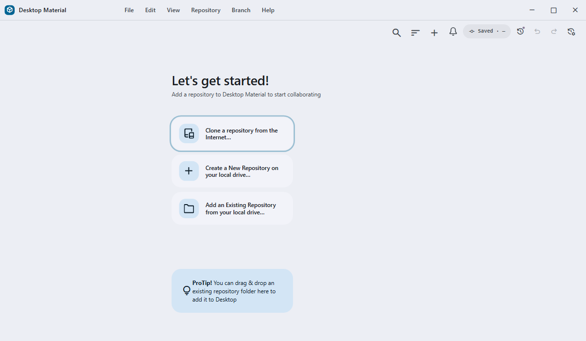

# Desktop Material

A Windows desktop client for Git and GitHub, with Material Design 3 controls and a workspace for reviewing changes, managing repositories, and collaborating on code. Desktop Material is an independent project based on GitHub Desktop.

Desktop Material 係 Windows 上嘅 Git 同 GitHub 桌面用戶端，以 Material Design 3 介面整理儲存庫、覆核改動同協作流程。呢個項目建基於 GitHub Desktop，並非 GitHub 官方產品。

[**Download v4.0.133501**](https://github.com/Ding-Ding-Projects/desktop-material/releases/tag/v4.0.133501) · [**Documentation**](https://ding-ding-projects.github.io/desktop-material/) · [**Feature guide**](docs/features/README.md)

Latest maintenance source record: [October 15 bug audit](docs/features/quality-and-reliability/bug-audit-2026-10-15.md), with nine fixes, focused test results, and separate release-verification limits.

## Get Desktop Material / 安裝

The supported release targets **Windows x64** and installs for the **current user**.

1. Open the [release download page](https://github.com/Ding-Ding-Projects/desktop-material/releases/tag/v4.0.133501).
2. Download `GitHubDesktopSetup-x64.exe`.
3. Close Desktop Material, run the setup executable, and open the application after installation.

The release also includes a portable ZIP. Extract it completely before running its executable. Windows packages are intentionally unsigned; keep your existing security protections enabled.

目前版本支援 Windows x64，安裝範圍係目前用戶。下載安裝程式前先睇版本說明，安裝前關閉 Desktop Material。套件刻意保持未簽署，請保留現有安全設定。

For an installation managed from PowerShell, review the [installation guide](docs/readme-tabs/install.md) and [installer helper](script/install-windows.ps1), then run this from a trusted checkout in normal, non-administrator PowerShell:

```powershell
.\script\install-windows.ps1 -Operation Install -InstallScope CurrentUser
```

The helper verifies the selected stable release download before invoking Squirrel. Its supported operations are `Install`, `Update`, and `Uninstall`; it does not force-close a running application.

**Current verification:** the published v4.0.133501 package has passed complete archive integrity checks, its release assets match their published digests, and it contains no `windows-argv-parser.node`. The corrected package also reaches a usable isolated-profile workspace and passes second-instance and custom-editor argument checks. Installed startup and startup with an existing profile are still being verified.

**目前驗證狀態：** v4.0.133501 套件完整性同下載摘要已核對，套件亦冇 `windows-argv-parser.node`。隔離設定檔啟動同參數工作流程已通過；安裝後啟動同現有設定檔啟動仍然驗證中。

## Verified startup capture / 啟動畫面驗證



This genuine v4.0.133501 capture shows the empty workspace after local setup in an isolated profile. All three starting actions are enabled. It is bound to source 1ef2e137353ea431082d7bbd2026ad14be16f561 and the verified Squirrel package; [the dated record](docs/verification/startup-repair-2026-10-11.md) retains the exact measured viewport, hashes and limits. Installed and current-profile acceptance remain incomplete.

呢張係 v4.0.133501 真正啟動畫面，使用隔離設定檔完成本機設定後擷取。三個開始操作都可用。現有安裝同原有設定檔嘅驗收仍然未完成，張圖只證明已核對套件嘅隔離啟動狀態。

## Work with your repositories / 儲存庫工作流程

Open or clone a repository, inspect its changes, and keep the next action close to the work.

| Task | Read more |
| --- | --- |
| Open, clone, organize, and navigate repositories | [Repository management](docs/features/repository-management/README.md) |
| Review changed files, diffs, images, and structured data | [Review and diff](docs/features/review-and-diff/README.md) |
| Create and review pull requests and inspect collaboration activity | [Collaboration](docs/features/collaboration/README.md) |
| Manage accounts, repository identities, tabs, and workspaces | [Identity and workspace](docs/features/identity-and-workspace/README.md) |
| Configure external editors, shells, and provider integrations | [Integrations](docs/features/integrations/README.md) |
| Adjust appearance, density, and accessibility preferences | [Design system](docs/features/design-system/README.md) |
| Use documented opt-in local automation | [Agent API](docs/features/agent-api/README.md) |
| Understand recovery and reliability behavior | [Quality and reliability](docs/features/quality-and-reliability/README.md) |

Each feature article describes its behavior, configuration, limitations, and verification. The [complete feature inventory](docs/readme-tabs/complete-feature-list.md) provides a searchable starting point for the full documentation.

由開啟或複製儲存庫開始，逐項覆核改動，再進行提交、同步或協作。各分類文章會列明操作方法、設定、限制同驗證狀態。

## Build from source / 由原始碼建置

Clone this repository on Windows, open a terminal in its root directory, and use the supported entrypoints:

```bat
build.bat /s
build-installer.bat /s
```

Both commands prepare missing supported build dependencies through the repository bootstrap and reuse valid tools and caches. `/s` selects silent operation. The first command builds the application; the second builds the application and produces its Squirrel installer. Both propagate a real failure status.

On machines with at most 12 GiB of physical memory, production compilation runs its six configurations sequentially with a direct 4 GiB old-space limit per Node process. Larger machines use the normal compilation route. To select sequential compilation explicitly in Command Prompt:

```bat
set DESKTOP_WEBPACK_SERIAL=1
build.bat /s
```

See the [development guide](docs/readme-tabs/development.md), [Windows setup](docs/contributing/setup-windows.md), and [startup and argument parsing guide](docs/features/quality-and-reliability/windows-startup-argument-parser.md) for supported tools and verification details.

兩個入口都會先準備缺少嘅建置工具，再執行實際建置。細記憶體主機會逐個編譯設定執行；每個子行程嘅限制唔等於整部機嘅總記憶體上限。

## Documentation / 文件

- [Documentation website](https://ding-ding-projects.github.io/desktop-material/)
- [Categorized feature articles](docs/features/README.md)
- [Wiki articles in this repository](docs/wiki/README.md)
- [GitHub wiki](https://github.com/Ding-Ding-Projects/desktop-material/wiki)
- [Installation and update guide](docs/readme-tabs/install.md)
- [Direct clone recovery and preservation](docs/features/repository-management/direct-clone-recovery.md), including the empty-container repair, 48 verified renderer presentation tuples and the normal released package; installed-profile acceptance remains pending. Current recovery images remain private because synthetic paths identify the host account.
- [Contributor setup](docs/contributing/setup.md)
- [Roadmap](ROADMAP.md)
- [Handoff](HANDOFF.md)

## License / 授權

Desktop Material is available under the [MIT license](LICENSE). It is based on [GitHub Desktop](https://github.com/desktop/desktop). GitHub's names and logos remain subject to their owners' trademark rights and [logo guidelines](https://github.com/logos).

Desktop Material 採用 MIT 授權。GitHub 名稱同標誌嘅商標權仍然屬於原權利人，使用時請遵守相關指引。
