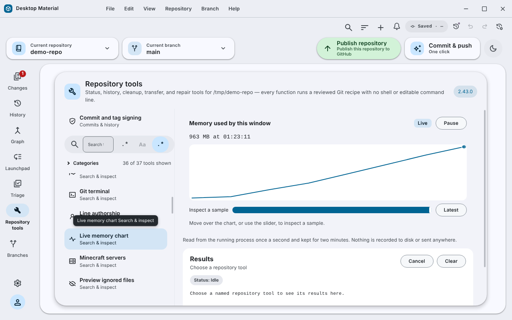

# Live charts / 即時圖表

A reusable line chart for values that change while you watch, and its first
use: **Repository tools → Live memory chart**, which shows the memory this
window is using.

可以重用嘅即時折線圖，第一個用途喺「Repository tools → Live memory chart」，睇到呢個
視窗用緊幾多記憶體。

## Behaviour

- One sample a second, kept for two minutes (120 samples). Older samples drop
  off the left.
- The newest value is always shown as text with its time. Move the pointer over
  the chart, or use the **Inspect a sample** slider (arrow keys, Home and End),
  to read any sample; **Latest** returns to the newest.
- **Pause** stops sampling. The line holds its last real value and the message
  says when it paused. **Resume** carries on.
- States: Loading (waiting for the first sample), Live, Paused, and Stale (no
  new sample for five seconds). A stale chart says so; it never estimates or
  extends the line.
- The picture has a one-sentence description for screen readers: latest,
  lowest, highest, the time span and whether it is rising, falling or steady.
- The live dot pulses only at the Full and Calm motion levels and stops when
  the Charts surface is switched off in the motion settings.

## How it is built

- `app/src/lib/live-chart.ts`: the window, scaling, state, trend and
  description rules.
- `app/src/ui/lib/live-chart.tsx`: the chart component.
- `app/src/ui/repository-tools/app-memory-chart.tsx`: reads
  `process.memoryUsage().rss` in the window's own process.
- `app/styles/ui/_live-chart.scss`.

## Failure modes

A reading that fails is skipped, so the chart turns stale by itself. Values
that are not finite numbers are refused.

## Security considerations

The figure is read locally and kept in memory only. Nothing is written to disk
or sent anywhere.

## Verification

`app/test/unit/live-chart-test.ts` (6 tests) and
`app/test/unit/ui/app-memory-chart-test.tsx` (2 tests) pass on Linux, and the
TypeScript check passes. The built Windows application has not been checked and
no capture exists yet.

## Picture

This is not a Windows capture. See [how it was made](../../assets/linux-run/README.md).
