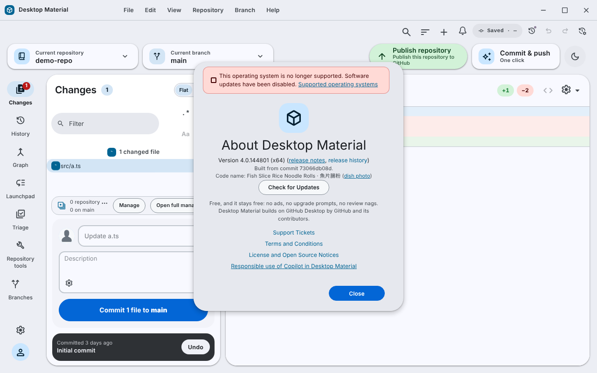

# About: build commit, code name and the free note / 關於：組建來源、代號同免費聲明

**Help → About Desktop Material** now says which commit the running build was
made from, and states that the app is free.

「Help → About Desktop Material」而家會講呢個組建係由邊個 commit 整出嚟，同埋寫明
呢個 app 係免費。

## What it shows

- `Built from commit <first ten characters>.` under the version, selectable so
  it can be copied into a report. If the build did not record a commit, it says
  so instead of showing a made-up value.
- `Free, and it stays free: no ads, no upgrade prompts, no review nags.
  Desktop Material builds on GitHub Desktop by GitHub and its contributors.`

## Code name

- `Code name: <dish>` with a link to the public dish photo, when the release
  has one. Every release is named after one dim sum dish.
- The release workflow picks the name when it publishes, after the app is
  built, so the app cannot carry its own name. When About opens, the app reads
  its own release's public notes from GitHub (one request, no sign-in sent)
  and shows the name from them. If that fails, the release has no name or the
  build is a development build, the line is simply absent.
- Only a photo link on the project's own dim sum photo releases is accepted;
  any other link in the notes is ignored.

## Not built

The time the build was made is not recorded.

## Verification

`build-provenance-test.ts` and `release-code-name-test.ts` pass on Linux, and
the parser was run against the newest published release's real notes. Seen in
release v4.0.144801 run under Linux with stand-in native modules: the commit,
the code name fetched from the release notes and the free note all appear.

This is not a Windows capture. See [how it was made](../../assets/linux-run/README.md).
