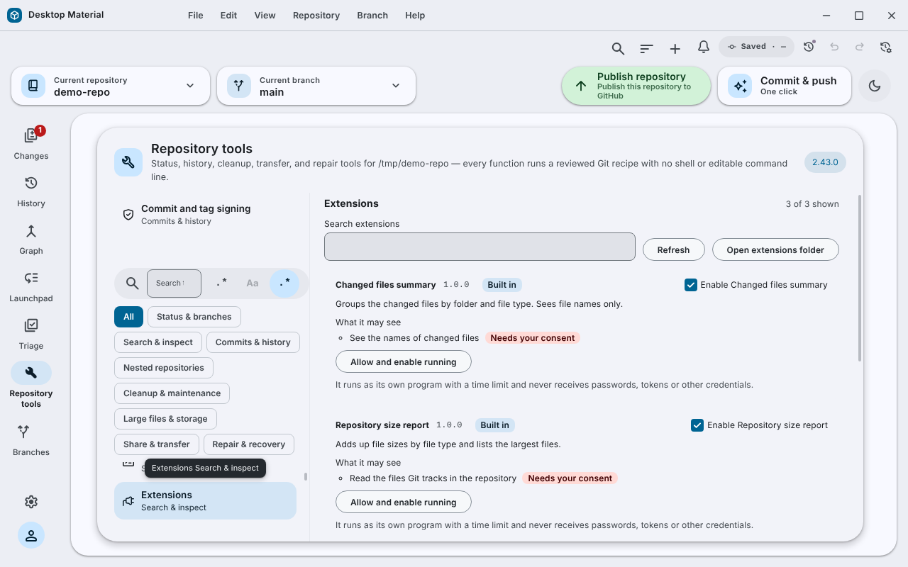

# Extensions / 擴充功能

**Repository tools → Extensions** runs small add-on programs on the selected
repository. An extension is a folder with a manifest. It runs as its own
process, so it can be written in any language, and it sees only what its
manifest declares and you have agreed to.

「Repository tools → Extensions」可以喺揀咗嘅儲存庫上面行細細個附加程式。每個擴充功能係
一個資料夾加一份清單，獨立行程咁行，用咩語言寫都得；佢只會見到清單寫明、你又同意咗嘅嘢。

## Using it

- Every extension is listed with its version, what it may see, and an on/off
  switch. Search filters the list.
- Nothing runs before **Allow and enable running** is pressed. If an update
  asks for something new, only the new item is marked **Needs your consent**
  and the extension stops running until you allow it. **Withdraw consent**
  takes it back.
- **Run on this repository** shows the result under the extension.
- A folder that cannot be used is still listed, with every reason.
- Three extensions are built in and double as samples: **TODO finder**,
  **Repository size report** and **Changed files summary**.

## Writing one

Put a folder in the extensions folder (**Open extensions folder**) with an
`extension.json`:

```json
{
  "manifestVersion": 1,
  "id": "line-counter",
  "name": "Line counter",
  "version": "1.0.0",
  "description": "Counts the changed files.",
  "permissions": ["changed-files"],
  "command": "python",
  "args": ["main.py"]
}
```

| Field | Rule |
| --- | --- |
| `id` | 3 to 50 lower-case letters, digits or hyphens; unique |
| `version` | `1.2.3` form |
| `permissions` | any of `repository-path`, `changed-files`, `branch-name`, `read-tracked-files` |
| `command` | a program on `PATH`, a path inside the folder, or `@app-node` for the app's own Node runtime |
| `args` | up to 32 strings |

The app starts the program in the extension's folder, writes one JSON request
to standard input and reads one JSON answer from standard output:

```json
{ "protocol": 1, "action": "run",
  "extension": { "id": "line-counter", "version": "1.0.0" },
  "changedFiles": ["src/a.ts", "README.md"] }
```

```json
{ "protocol": 1, "ok": true, "title": "2 files", "text": "src/a.ts\nREADME.md" }
```

To report a failure answer `{ "protocol": 1, "ok": false, "error": "why" }`.

A complete Python sample (`main.py`):

```python
import json, sys
request = json.load(sys.stdin)
files = request.get("changedFiles", [])
json.dump({"protocol": 1, "ok": True,
           "title": f"{len(files)} files", "text": "\n".join(files)}, sys.stdout)
```

The same in Node, using `"command": "@app-node", "args": ["main.js"]`:

```js
const request = JSON.parse(require('fs').readFileSync(0, 'utf8'))
const files = request.changedFiles || []
process.stdout.write(JSON.stringify({
  protocol: 1, ok: true, title: files.length + ' files', text: files.join('\n'),
}))
```

## Limits

- 10 seconds per run, then the program is stopped.
- At most 256 KB of output; the shown text is cut at 20,000 characters.
- At most 2,000 changed file names are sent, and 200 extensions are listed.

## Security considerations

- Fields are sent only when a declared, consented permission covers them.
  `repositoryPath` needs `repository-path` or `read-tracked-files`.
- The program gets a scrubbed environment (`PATH`, `SystemRoot`, `windir`,
  `TEMP`, `TMP` only). Tokens and passwords are never passed, by request or by
  environment.
- A `command` may not leave its folder with `..`.
- An extension is still a program running as you. Consent limits what the app
  hands it, not what the program can do on the computer. Install only
  extensions you trust.

## Known gaps

There is no screen for installing from a file or a URL.

## Verification

`app/test/unit/extensions-rules-test.ts` (8), `extension-host-test.ts` (6, with
real child processes, including the built-ins, the time limit and the output
limit) and `ui/extension-manager-test.tsx` (2) pass on Linux; the TypeScript
check passes. The built Windows application has not been checked, and the
built-ins have not been run through the packaged app's own Node runtime.

## Picture



This is not a Windows capture. See [how it was made](../../assets/linux-run/README.md).
