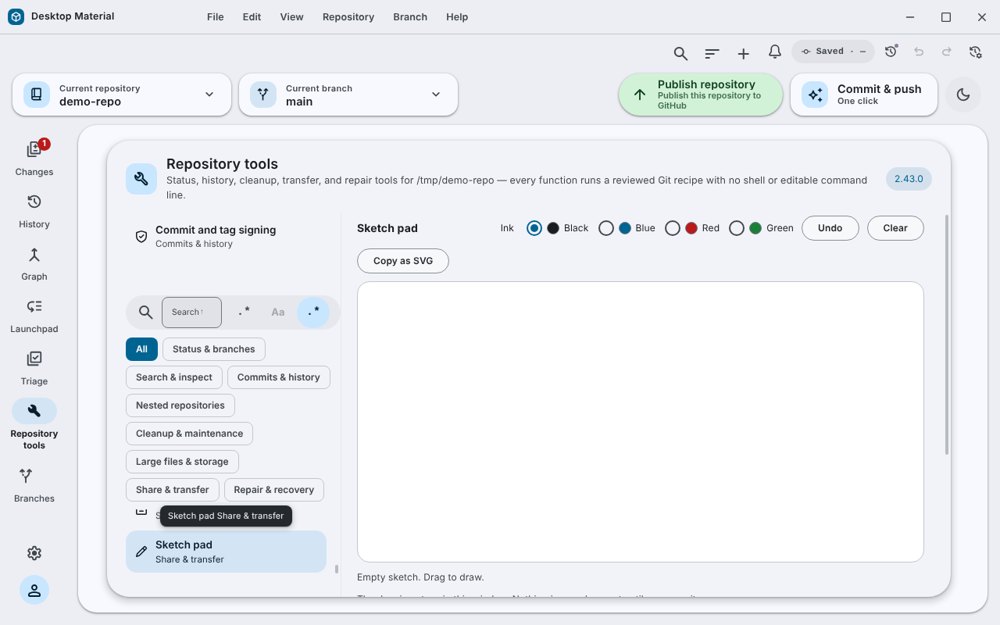

# Sketch pad / 畫板

**Repository tools → Sketch pad** is a small freehand drawing surface for a
quick diagram or annotation.

「Repository tools → Sketch pad」係一塊細畫板，畫個草圖或者標記吓。

## Behaviour

- Drag on the surface to draw. A tap leaves a dot.
- Four inks: Black, Blue, Red and Green, chosen with ordinary radio buttons.
- **Undo** removes the newest stroke, **Clear** removes everything, and
  **Copy as SVG** puts a self-contained SVG of the sketch on the clipboard.
  The three buttons are disabled while the sketch is empty.
- A sketch holds at most 500 strokes of 2,000 points each. When it is full the
  status line says so and asks you to undo or clear.
- The status line always says how many strokes there are; the surface carries
  the same description for screen readers.

## Limits

Drawing needs a pointer; there is no keyboard way to draw. Saving to a file and
attaching a sketch to a commit are not built: copy the SVG and paste it where
you need it.

## Security considerations

The drawing stays in the window's memory. Nothing is saved or sent until you
copy it.

## Verification

`app/test/unit/sketch-pad-test.ts` (5 tests) and
`app/test/unit/ui/sketch-pad-test.tsx` (1 test) pass on Linux, and the
TypeScript check passes. The built Windows application has not been checked and
no capture exists yet.

## Picture

This is not a Windows capture. See [how it was made](../../assets/linux-run/README.md).
