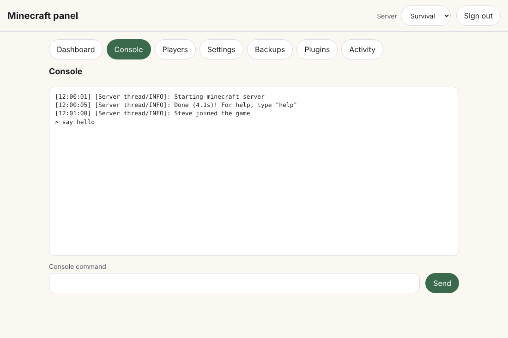
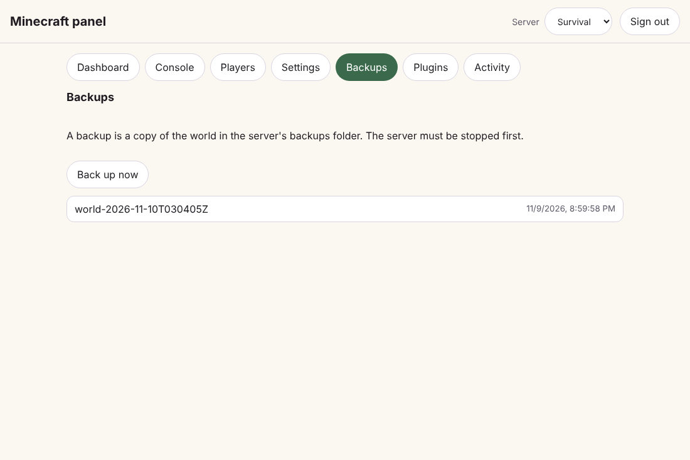
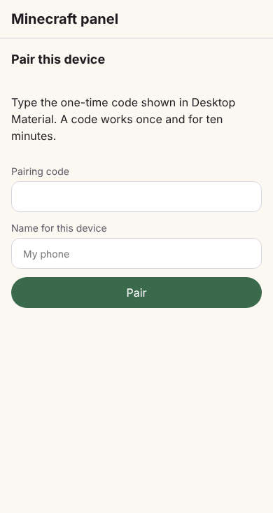

# Minecraft web panel, free public link and Discord webhook / Minecraft 網頁面板、免費公開連結同 Discord

**Repository tools → Minecraft servers → Web panel** serves a small panel for
your local Minecraft servers, can give it a free public link with one click,
and can tell a Discord channel the link every time it changes.

「Repository tools → Minecraft servers → Web panel」會開一個細細個嘅面板畀你管本機嘅
Minecraft 伺服器，撳一下就有免費公開連結，連結一變仲可以自動通知 Discord 頻道。

> [!IMPORTANT]
> Verified with unit tests and by loading the real panel page in Chromium on
> Linux against a stand-in server list. It has **not** been run against
> Cloudflare, Discord or a real Minecraft server, and not on Windows.

## The panel

- Listens only on this computer's loopback address (`127.0.0.1`, port 25580).
  It never opens a port on your network by itself.
- Pages: **Dashboard** (status, players online, port, memory, Start and Stop),
  **Console** (live output and a command line), **Players** (who is online,
  with Kick), **Settings** (ten `server.properties` values), **Backups** (copy
  the world, list the copies), **Plugins** (the jar files in `plugins/` and
  `mods/`, read-only) and **Activity** (what paired devices did, newest
  first).
- **Settings** can change only: message of the day, maximum players,
  difficulty, default game mode, PvP, allow-list, hardcore, flight, view
  distance and spawn protection. Each value is checked. Nothing else in the
  file can be written from the panel; `online-mode`, `level-name` and the
  remote-console keys are deliberately left out. A running server reads the
  file the next time it starts.
- **Backups** copies the world folder into `backups/<world>-<UTC time>/` in the
  server folder. The server must be stopped first, so a copy is never taken
  from a world that is being written. At most 50 are kept; restoring and
  deleting are done in the folder, not from the panel.
- Works on a phone-width screen, follows light and dark mode, and has no
  animation when reduced motion is requested.

## Pairing

- Nothing answers without a paired session except the page itself and the
  pairing request.
- **New pairing code** shows an eight-character code. It works once, for 10
  minutes. Eight wrong guesses pause pairing for ten minutes.
- A paired device holds a random session for 30 days. Only a SHA-256 digest of
  it is stored, so the saved list cannot be used to sign in.
- Paired devices are listed in the app and can be removed one by one or all at
  once. Signing out on the device removes it too.

## Free public link

- **Start free public link** turns the panel on if needed and runs
  `cloudflared tunnel --no-autoupdate --url http://127.0.0.1:<port>`.
- `cloudflared` must already be installed on this computer. The app does not
  download it.
- The link is a random `https://….trycloudflare.com` address. It is a new
  address every time it starts, has no uptime guarantee, and serves at most 200
  requests at once. The card says so.
- If the helper exits, the card says the link no longer works.

## Discord webhook

- Paste a Discord webhook address and **Save webhook**. It is stored in the
  operating-system vault and is never shown again, logged, put in an error or
  written to the settings file.
- The link is sent when it appears. With **Send again when the link changes**
  on, a new link is sent automatically, either by updating the earlier message
  or by posting a new one. **Say when the panel goes offline** sends a notice
  when the link stops.
- **Send a one-time pairing code with the link** is off by default. When on,
  each message carries a fresh code, and **Send now** sends another. The card
  warns that anyone who can read that channel can pair a device.
- **Send now** always sends. A failed delivery is shown on the card without the
  address and is retried on the next change or **Send now**.
- Mentions are switched off in every message.

## Security considerations

- Changes need a paired session, a JSON body of at most 4 KB and a request
  header that a cross-site form cannot set. The session cookie is `HttpOnly`
  and `SameSite=Strict`, and `Secure` when the request arrived over HTTPS.
- Every response carries a strict Content-Security-Policy, forbids framing and
  is not cached. The page writes console text and player names as text only.
- Console commands are one line of at most 256 characters; Kick accepts only a
  Java Edition player name.
- A public link puts the pairing page on the internet. Anyone paired can run
  console commands on your servers, so hand out codes with care.

## Not built

Files, configuration, plugins, backups and schedules pages; a named tunnel on
your own domain; downloading or verifying `cloudflared`; a WebSocket console
(the console polls once a second).

## Verification

`web-panel-hosting-test.ts`, `web-panel-pairing-test.ts`, `minecraft-properties-test.ts`,
`web-panel-server-test.ts` (real loopback requests),
`web-panel-controller-test.ts` (stand-in tunnel helper, vault and Discord) and
`ui/web-panel-card-test.tsx`.
