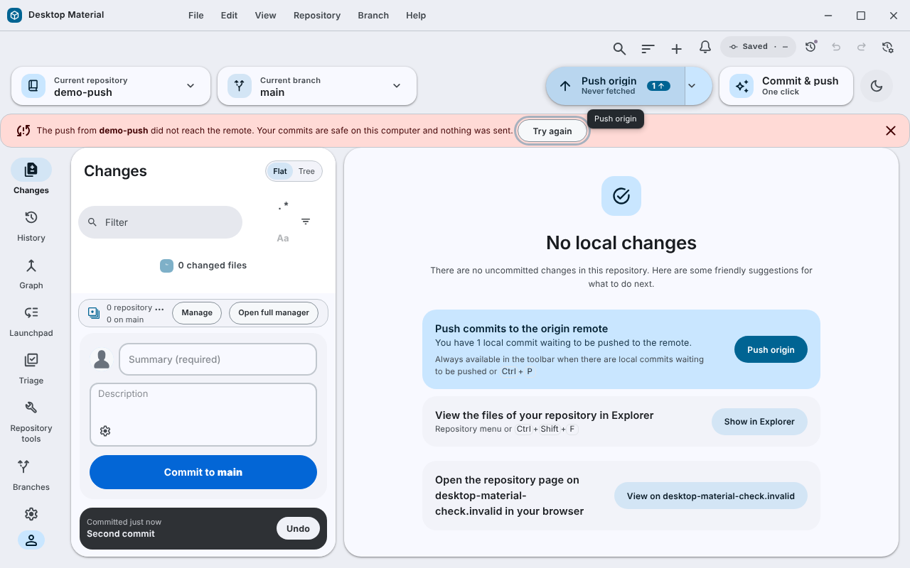

# Push did not reach the remote: a banner with Try again / 推送去唔到遠端：有「再試」嘅橫額

When a push you started cannot reach its remote at all, Desktop Material now
shows a banner that says your commits are safe and offers **Try again**. Before
this, the same failure showed the general error notice with Git's raw message
and no way to retry from it.

你自己撳嘅推送如果根本連唔到遠端，而家會出一條橫額，講明 commit 安全，仲有「Try again」。
之前係出一般嘅錯誤通知，得 Git 原文，冇得直接再試。

## Behaviour

- The banner says the push from that repository did not reach the remote, that
  your commits are safe on this computer and that nothing was sent.
- **Try again** runs the same push again and closes the banner. The banner can
  also be dismissed.
- It applies only when Git's output says the host could not be reached (the
  name could not be looked up, the connection was refused or timed out, or
  there is no network), the
  push was started by you (not a background task), and the app knows how to
  retry it. Every other push failure, such as a rejected push or a sign-in
  problem, keeps its existing handling.
- If the retry fails for another reason, that failure is reported the usual
  way.

## Pull and fetch

A pull or fetch that could not reach its remote keeps the app's usual error
notice, and that notice now carries **Try again** too. It runs the same pull
or fetch again and closes the notice. The button is offered only when Git's
output says the host could not be reached; a sign-in failure, a rejection or a
missing repository gets no retry button, because trying again would not help.
A background push that fails the same way gets the same button on its notice.

## Accessibility

The message is announced as an alert, the banner stays until it is dismissed
or retried, and both actions are ordinary buttons.

## Verification

`push-did-not-reach-remote-test.tsx` covers the handler, the output patterns
and the banner on Linux. Published release v4.0.143401, which had the first
version of this, was run under Linux against a repository whose remote name
cannot be looked up: the banner did **not** appear and the general error
notice did, because Git's own classification does not cover a failed name
lookup during a push. The handler now reads Git's output for that. The
corrected version was then seen in release v4.0.143901 run the same way: the
banner appeared and the general notice did not. Try again on the banner was pressed in
a later run with an inconclusive result. The retry button on pull and fetch
notices is covered by unit tests and has not been seen in a running build.
Nothing was checked on Windows.

This is not a Windows capture. See [how it was made](../../assets/linux-run/README.md).
